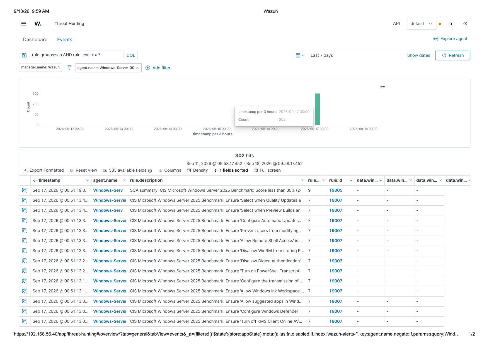

# IT General Controls (ITGC) Risk Assessment — Windows Server & Endpoint Environment

A controls-focused risk assessment of two Windows systems (a domain server and an endpoint), written the way an IT auditor or GRC analyst would document it: control objective, observed gap, business risk, and remediation — not a vulnerability-by-vulnerability technical writeup.

The underlying technical work (SIEM deployment, log analysis, compliance scanning) was performed as part of a broader hands-on security engagement. **This repo is a deliberate reframing of a subset of that work** — specifically the configuration-compliance and audit-trail findings — into the structure a controls assessment, SOC 2 readiness review, or internal audit of IT general controls would actually take. The full technical engagement, including application-layer penetration testing, is documented separately: [vulnerability-assessment-project](https://github.com/oluwafemi-olagunju/vulnerability-assessment-project).

## Why a separate writeup

A penetration test report and a controls assessment answer different questions for different readers. A pentest report tells a technical team "here is a chain we exploited." A controls assessment tells a risk committee or auditor "here is a control that isn't operating as designed, here is the exposure that creates, and here is what closes it, in what order." Same underlying facts, different lens — and GRC roles hire for the second lens.

## Scope & methodology

- **In scope:** two Windows systems — one domain-joined server, one client endpoint — assessed against their applicable CIS Benchmark (CIS Windows Server 2025 Benchmark; CIS Windows 11 Enterprise Benchmark v3.0.0).
- **Methodology:** automated SCA (Security Configuration Assessment) scanning against each benchmark, cross-checked against direct host-level evidence (`auditpol`, firewall profile state) rather than taken at face value — the same "verify, don't assume" standard a control test should be held to.
- **Out of scope for this writeup:** the application-security and phishing-simulation findings from the broader engagement, which are penetration-testing deliverables, not controls-assessment deliverables, and are documented in the companion repo linked above.

## Executive summary

Both systems fail **over 70% of their applicable CIS benchmark controls** — a result that looks worse than it is operationally, and better than it should when you look at *which* controls are failing. The network perimeter around these systems is well hardened (minimal exposed services, SMB signing enforced, host-based firewalls active). The gap is entirely in configuration hardening and audit-trail completeness *behind* that perimeter — the layer that determines whether an incident would actually be detected and investigable, not whether it's preventable at the network edge.

Three gaps carry outsized risk relative to the rest of the compliance deficit, because they compound the one service this environment actually exposes externally (remote administration over WinRM) with a reduced ability to detect misuse of it:

1. **Remote-access hardening controls are failing specifically on the server** that exposes remote administration — the compliance gap and the attack surface overlap directly.
2. **No audit trail exists for firewall-level network activity** on either system — there is currently no way to reconstruct what connections were allowed or blocked after the fact.
3. **Process-execution auditing is inconsistently enabled** across the two systems, creating a detection blind spot on one host that doesn't exist on the other, for no documented reason.

None of this was found by running an exploit. It was found by scanning against a published benchmark and then confirming the scan's result directly against the host's own configuration state — the standard a controls test should meet.

## Compliance scorecard

| System | Benchmark | Controls Failed | Pass Rate |
|---|---|---|---|
| Domain Server | CIS Windows Server 2025 Benchmark | 302 | < 30% |
| Client Endpoint | CIS Windows 11 Enterprise Benchmark v3.0.0 | 355 | < 30% |

A sub-30% pass rate against a CIS benchmark is a material finding on its own — but a raw score without risk-weighting isn't actionable. The risk register below weights these findings by exploitability and business impact rather than treating all 657 failed controls as equally urgent.

*SCA (Security Configuration Assessment) scan output — CIS Windows Server 2025 Benchmark, 302 failed controls. The visible failing controls (Remote Shell Access, WinRM RunAs credential storage, Digest authentication, PowerShell Transcription) are the ones carried into R-01 and R-03 of the risk register below.*

## Key risk findings

Full detail, including framework mapping, is in [RISK-REGISTER.md](RISK-REGISTER.md). Top items:

| ID | Control Domain | Risk | Why it's prioritized |
|---|---|---|---|
| R-01 | Remote Access Configuration | High | Fails on the one system that exposes a remote-management service externally — the gap and the exposure are the same surface |
| R-02 | Audit Log Management (Network) | High | Zero audit trail for allowed/blocked network connections on either system |
| R-03 | Audit Log Management (Process) | Medium | Process-creation auditing enabled on one system, disabled on the other, with no risk-based justification found for the difference |
| R-04 | Account Lockout / Authentication | Medium | No lockout policy on either system — exposure is currently masked by benign observed activity, not by a control |
| R-05 | Password Policy | Low–Medium | Password history enforcement failing on the client endpoint |

## Remediation roadmap

| Horizon | Action |
|---|---|
| **Immediate (0–30 days)** | Harden WinRM configuration on the server (disable Digest authentication, restrict Remote Shell Access, disallow RunAs credential caching) |
| **Short-term (30–90 days)** | Enable Windows Firewall connection logging on both systems; reconcile Process Creation auditing so both systems match; enable PowerShell Script Block/Transcription logging on both systems |
| **Medium-term (90+ days)** | Implement an account lockout policy and enforce password history consistently across both systems |
| **Ongoing program** | Build a phased plan against the remaining compliance gap — 657 failed controls across two benchmarks cannot be closed in one remediation cycle; sequence by exploitability and exposure, not benchmark section order |

## Framework references used

Findings in the risk register are cross-referenced to:
- **CIS Critical Security Controls v8** (Controls 4, 5, 6, and 8 — Secure Configuration, Account Management, Access Control Management, and Audit Log Management)
- **NIST Cybersecurity Framework** functions (primarily Protect and Detect)

This is a deliberate choice: mapping findings to a named framework is what turns "we found some misconfigurations" into something a risk committee, auditor, or compliance function can act on and track against.

## About this assessment

I built this from an end-to-end security engagement I ran and presented live (SIEM deployment, Windows log forensics, mobile application testing — see the companion technical repo). My background is in AML and financial-crime compliance investigation, which is a closer analogue to IT audit/GRC work than it might look at first: both disciplines are fundamentally about testing whether a control is *actually operating as designed*, not just documented as existing, and translating a technical or transactional gap into a risk narrative a non-technical stakeholder can act on. This writeup is that same discipline applied to IT general controls instead of transaction monitoring rules.
