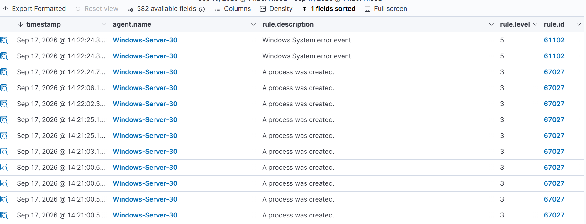
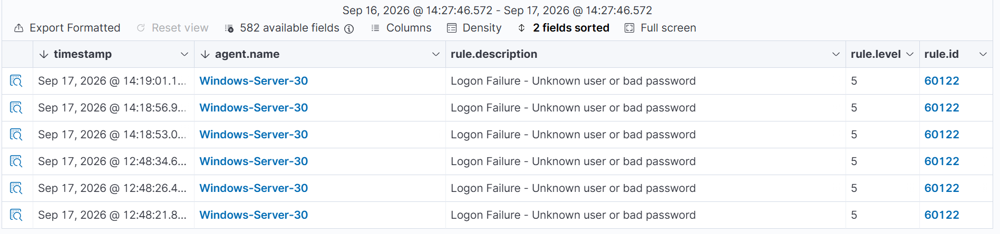

# Risk Register — Windows ITGC Assessment

Detailed findings from the compliance scan and audit-trail review summarized in the [README](README.md). Each entry follows a standard control-test structure: control objective, observed condition, risk rating, business impact, remediation, and the framework reference used to justify prioritization.

Risk rating combines likelihood (how directly exploitable the gap is, given the environment's actual exposure) and impact (what an attacker or auditor would find if the gap were exploited or tested) — not raw CIS severity alone, since a benchmark's severity level doesn't account for an organization's specific exposure.

---

### R-01 — Remote access configuration hardening

| Field | Detail |
|---|---|
| **Control objective** | Remote administrative access (WinRM) should be configured to resist credential theft and unauthorized shell access |
| **Observed condition** | On the domain server, Digest authentication is permitted, Remote Shell Access is allowed without restriction, and RunAs credential caching is not disabled |
| **Why it's rated High** | This server's only externally reachable service *is* WinRM — these three failing controls are not abstract hardening gaps, they directly weaken the one administrative pathway an attacker could actually reach |
| **Risk rating** | High |
| **Business impact** | Credential exposure or unauthorized remote shell access to a domain server, with no network-layer control positioned to catch it, since the perimeter scan separately confirmed WinRM as an intentionally exposed, not accidentally exposed, service |
| **Remediation** | Disable Digest authentication; restrict Remote Shell Access to authorized administrative accounts/IP ranges; disable RunAs credential caching |
| **Target horizon** | Immediate (0–30 days) |
| **Framework reference** | CIS Controls v8 — Control 4 (Secure Configuration of Enterprise Assets and Software); NIST CSF — PR.PT (Protect: Protective Technology) |

---

### R-02 — Network-level audit logging absent

| Field | Detail |
|---|---|
| **Control objective** | Network connection activity (allowed and blocked) should be logged to support incident reconstruction |
| **Observed condition** | Neither system has a Windows Firewall log destination configured on any profile — there is currently zero audit trail of connection activity |
| **Risk rating** | High |
| **Business impact** | In the event of a security incident, there would be no way to reconstruct which connections were attempted, allowed, or blocked at the host firewall layer — a direct gap in incident-response readiness, independent of whether an incident has occurred |
| **Remediation** | Enable Windows Firewall connection logging (both allowed and blocked events) on all profiles, on both systems |
| **Target horizon** | Short-term (30–90 days) |
| **Framework reference** | CIS Controls v8 — Control 8 (Audit Log Management); NIST CSF — DE.CM (Detect: Continuous Monitoring) |

---

### R-03 — Inconsistent process-execution auditing

| Field | Detail |
|---|---|
| **Control objective** | Process creation should be audited consistently across systems of the same tier to support detection and investigation |
| **Observed condition** | Direct verification (`auditpol /get /subcategory:"Process Creation"`) confirmed the server has this subcategory enabled; the client endpoint does not, and shows zero process-creation events despite constant routine process activity |
| **Risk rating** | Medium |
| **Business impact** | A detection blind spot exists on the endpoint tier that does not exist on the server tier, with no documented security rationale for the asymmetry — most likely an artifact of how the environment was originally provisioned rather than a deliberate risk decision, which is itself a governance gap worth flagging |
| **Remediation** | Enable Process Creation auditing and command-line logging on the client endpoint to match the server baseline; document the decision so future provisioning doesn't silently drift again |
| **Target horizon** | Short-term (30–90 days) |
| **Framework reference** | CIS Controls v8 — Control 8 (Audit Log Management); NIST CSF — DE.CM |

---

### R-04 — No account lockout policy

| Field | Detail |
|---|---|
| **Control objective** | Repeated authentication failures against an account should be rate-limited or locked out |
| **Observed condition** | Neither system enforces an account lockout policy; observed authentication activity during the assessment period was low-volume and consistent with legitimate manual use, but nothing in the configuration itself would have capped a higher-volume attempt |
| **Risk rating** | Medium |
| **Business impact** | Current exposure is masked by benign observed behavior, not by an actual control — a credential-stuffing or brute-force attempt against either system today would not be rate-limited at all |
| **Remediation** | Implement an account lockout policy (threshold and duration per organizational standard) on both systems |
| **Target horizon** | Medium-term (90+ days) |
| **Framework reference** | CIS Controls v8 — Control 6 (Access Control Management); NIST CSF — PR.AC (Protect: Identity Management and Access Control) |

---

### R-05 — Password history not enforced

| Field | Detail |
|---|---|
| **Control objective** | Password reuse should be restricted via enforced password history |
| **Observed condition** | Password history enforcement fails the applicable benchmark control on the client endpoint |
| **Risk rating** | Low–Medium |
| **Business impact** | Compounds R-04 — in an environment with no lockout policy, weak password-rotation hygiene has a longer effective exposure window |
| **Remediation** | Enforce password history per organizational policy on the client endpoint |
| **Target horizon** | Medium-term (90+ days) |
| **Framework reference** | CIS Controls v8 — Control 5 (Account Management); NIST CSF — PR.AC |

---

### R-06 — Broader benchmark compliance gap

| Field | Detail |
|---|---|
| **Control objective** | Systems should be configured against an organization-adopted hardening baseline |
| **Observed condition** | Both systems score under 30% against their applicable CIS benchmark (302 failed controls on the server; 355 on the endpoint) — the five findings above account for a small fraction of the total gap |
| **Risk rating** | Informational / Programmatic — individually low-urgency controls in bulk represent a governance and resourcing gap, not a single exploitable risk |
| **Business impact** | Without a prioritized, phased remediation program, the organization has no realistic path to benchmark conformance, which itself becomes an audit and (where applicable) regulatory finding |
| **Remediation** | Establish a phased hardening program sequenced by exploitability and exposure (per the roadmap in the README), not by benchmark section order; track progress against the benchmark on a recurring cadence rather than as a one-time remediation sprint |
| **Target horizon** | Ongoing program |
| **Framework reference** | CIS Controls v8 — Control 4; NIST CSF — PR.IP (Protect: Information Protection Processes and Procedures) |
